# AI Dub Player — Architecture (`ARCH.md`)

## 1. Kiến trúc tổng thể (Hoàn chỉnh Phase 1 Web + Phase 2 Chrome Extension)

```mermaid
flowchart TD
  subgraph Client["Client Layer"]
    Web["Web Dub Player (Next.js App Router + DubPlayer + BillingModal + JobHistoryList)"]
    Ext["Chrome Extension MV3 (YouTubePageDetector + InPageTriggerButton + YouTubePlayerSyncBridge + InPageControlWidget)"]
  end

  subgraph BFF["API Gateway / BFF (Next.js Route Handlers)"]
    AuthAPI["Auth + Plan + Credit (/api/auth/*)"]
    BillAPI["Billing & Ledger API (/api/billing/plans, /api/billing/checkout, /api/billing/ledger)"]
    OrchAPI["Dub Job Orchestrator (/api/dub-jobs, /api/dub-jobs/by-video, /api/dub-jobs/:id/cancel, /api/dub-jobs/:id/retry)"]
    TranscriptAPI["Transcript API (/api/dub-jobs/:id/transcript)"]
    TransAPI["Translation API (/api/dub-jobs/:id/translate, /api/dub-jobs/:id/translation)"]
    CastAPI["Casting & Voices API (/api/dub-jobs/:id/speakers, /api/speakers/:id/voice, /api/voices, /api/voice-presets)"]
    PlayAPI["Playback & Subtitles API (/api/dub-jobs/:id/render, /api/dub-jobs/:id/playback, /api/dub-jobs/:id/subtitles)"]
    SSEAPI["Progress & SSE Service (/api/dub-jobs/:id/events)"]
  end

  subgraph Engine["Dub Engine Core & Workers (src/server/services)"]
    BillSvc["BillingService"]
    IngestWorker["JobQueueService & IngestWorker"]
    TransVerSvc["TranscriptVersionService"]
    TransSvc["TranslationService"]
    CastSvc["CastingService"]
    PlayManifestSvc["PlaybackManifestService"]
    Aligner["TimingAligner"]
    SubSvc["SubtitleService"]
    Mixer["AudioSegmentScheduler"]
  end

  subgraph Providers["Provider Adapters (src/server/providers)"]
    AsrAdapter["AsrProvider"]
    DiarizeAdapter["DiarizationProvider"]
    TransAdapter["TranslationProvider"]
    TtsAdapter["TtsProvider"]
    BillAdapter["BillingProvider (Stripe/Lemon Adapter)"]
  end

  subgraph Infra["Infrastructure & Persistence"]
    DB[("Prisma DB (User, CreditLedger, DubJob, Speaker, Transcript, Translation, Voice, VoiceAssignment, AudioSegment, SubtitleTrack)")]
    Storage[("S3-Compatible Object Storage Adapter")]
    EventBus["Realtime SSE Event Bus"]
  end

  Web --> AuthAPI
  Web --> BillAPI
  Web --> OrchAPI
  Web --> TranscriptAPI
  Web --> TransAPI
  Web --> CastAPI
  Web --> PlayAPI
  Web --> SSEAPI
  Ext --> OrchAPI
  Ext --> CastAPI
  Ext --> PlayAPI
  Ext --> Mixer
  BillAPI --> BillSvc
  BillSvc --> BillAdapter
  BillSvc --> DB
  OrchAPI --> IngestWorker
  IngestWorker --> TransVerSvc
  IngestWorker --> TransSvc
  IngestWorker --> CastSvc
  IngestWorker --> PlayManifestSvc
  PlayAPI --> PlayManifestSvc
  PlayAPI --> SubSvc
```

## 2. Nguyên tắc kiến trúc đã thực thi xuyên suốt (D1 – D6 & E1 – E2)

1. **Web App và Chrome Extension dùng chung một `Dub Engine` & `AudioSegmentScheduler`:**
   - Cả `DubPlayer` trên Web (`D5`) và `ExtensionAudioController` trên Chrome Extension (`E2`) đều dùng chung `AudioSegmentScheduler` và `PlaybackManifestService`, đảm bảo trải nghiệm đồng bộ âm thanh, phụ đề và fallback an toàn đồng nhất 100%.
2. **Đồng bộ chặt chẽ với `<video>` gốc của YouTube & Tự phục hồi âm lượng (`E2`):**
   - `YouTubePlayerSyncBridge` chụp lại `initialVolume` và `initialMuted` của thẻ `<video>` YouTube trước khi bật lồng tiếng, tự động dừng audio dub khi video YouTube `pause` / `seeking`, và khôi phục nguyên trạng âm lượng gốc khi tắt dub hoặc chuyển trang SPA.
3. **TTS theo từng segment & Cô lập Re-synthesis theo Speaker (`D4` / `D5` / `E2`):**
   - Đổi giọng một nhân vật trên Web hoặc ngay trong widget YouTube (`PATCH /api/speakers/:id/voice`) chỉ re-render các `AudioSegment` của nhân vật đó (`version` tăng lên), giữ nguyên `AudioSegment` của các nhân vật khác.
4. **Kiểm toán Credit bất biến & Hoàn trả nguyên tử (`D1` / `D6`):**
   - Mọi thay đổi số dư credit đều ghi vào `CreditLedger`; hủy tiến trình đang chạy hoàn trả 100% credit đã giữ.
